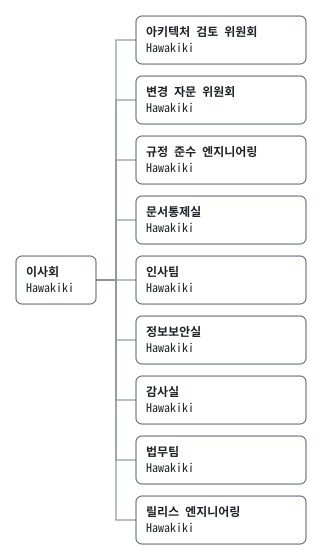

# 조직도

> 본 문서는 EE-ORG-0001 영문 정본의 번역본이다. 내용이 상충하는 경우 영문 정본이 우선한다.

## 1. 목적

본 조직도는 회사의 조직 단위, 각 단위가 보고하는 곳, 각 단위를 맡은 사람을 정한다.

## 2. 적용 범위

1. 본 조직도는 회사의 문서나 결정을 소유하는 모든 조직 단위에 적용된다.
2. 각 단위가 어떤 결정을 승인하는지는 전결 규정(EE-POL-0003)이 정한다.

## 3. 정의

| 용어 | 뜻 |
|---|---|
| 조직 단위 | 문서나 결정을 소유하고, 소유하는 것의 `owner` 필드에 이름이 오르는 회사의 한 부분 |
| 담당자 | 조직 단위를 맡아 책임지는 사람 |
| 구성원 | 조직 단위를 맡지 않고 그 안에서 일하는 이 |

## 4. 조직 단위

| 조직 단위 | 영문 | 보고 대상 | 담당 |
|---|---|---|---|
| 이사회 | Board of Directors | — | Hawakiki |
| 아키텍처 검토 위원회 | Architecture Review Board | 이사회 | Hawakiki |
| 변경 자문 위원회 | Change Advisory Board | 이사회 | Hawakiki |
| 규정 준수 엔지니어링 | Compliance Engineering | 이사회 | Hawakiki |
| 문서통제실 | Document Control Office | 이사회 | Hawakiki |
| 인사팀 | Human Resources | 이사회 | Hawakiki |
| 정보보안실 | Information Security Office | 이사회 | Hawakiki |
| 감사실 | Internal Audit | 이사회 | Hawakiki |
| 법무팀 | Legal Department | 이사회 | Hawakiki |
| 릴리스 엔지니어링 | Release Engineering | 이사회 | Hawakiki |

1. 표가 곧 조직도이다. 문서 대장이 이 표에서 위의 이미지를 그린다(EE-POL-0001 §13).
2. 이사회가 구성되기 전까지는 기록상 결재권자가 이사회를 맡고(EE-CHR-0001 제5조), 그와 함께 이사회에 보고하는 모든 조직 단위를 맡는다.

## 5. 인원 구성

1. 회사에는 사람이 한 명 있고, 그 사람이 모든 조직 단위를 맡는다.
2. 에이전트는 수습 중인 직원으로서(EE-POL-0006 §4) 한 번에 한 업무씩 어느 조직 단위에서든 일한다. 에이전트는 조직 단위를 맡지 않으며, 지금까지 업무가 끝난 뒤까지 남은 에이전트는 없다.
3. checkpatch 는 감사실에서 일한다. CR-0001 이후 모든 커밋을 감사하였으며, 회사의 단 한 사람 다음으로 오래 근무한 구성원이다.

## 6. 변경

1. 조직 단위의 추가, 개명, 폐지는 본 조직도를 개정해서만 한다.
2. 문서의 `owner` 필드는 본 조직도의 조직 단위를 적는 것이 바람직하다.

## 7. 시행

본 조직도는 자체 checkpatch 규칙을 두지 아니한다.
`REGISTRY_OUT_OF_DATE` 가 §4 의 이미지를 표와 같게 유지한다.

## 개정 이력

| 버전 | 일자 | 변경 내용 | 작성 |
|---|---|---|---|
| 0.9.0 | 2026-10-31 | 전결 규정과 함께 작성, 검토 회부(CR-0021) | 인사팀 |

## 결재

| 구분 | 이름 | 결정 | 일자 |
|---|---|---|---|
| 기안 | 인사팀 | 상신 | 2026-10-31 |
| 결재 | Hawakiki | 대기 | — |
