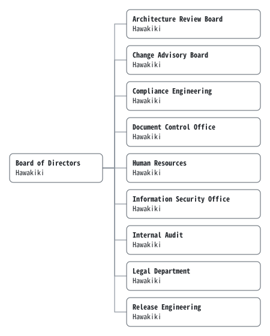

# Organization Chart

## 1. Purpose

This chart sets the units of the Company, whom each reports to, and who holds each.

## 2. Scope

1. This chart covers every unit that owns a document or a decision of the Company.
2. Which decisions each unit approves is set by the Delegation of Authority (EE-POL-0003).

## 3. Definitions

| Term | Meaning |
|---|---|
| Unit | A part of the Company that owns documents or decisions, and is named in the `owner` field of what it owns. |
| Holder | The person who holds a unit and answers for it. |
| Staff | Whoever works in a unit without holding it. |

## 4. Units

| Unit | Korean | Reports to | Held by |
|---|---|---|---|
| Board of Directors | 이사회 | — | Hawakiki |
| Architecture Review Board | 아키텍처 검토 위원회 | Board of Directors | Hawakiki |
| Change Advisory Board | 변경 자문 위원회 | Board of Directors | Hawakiki |
| Compliance Engineering | 규정 준수 엔지니어링 | Board of Directors | Hawakiki |
| Document Control Office | 문서통제실 | Board of Directors | Hawakiki |
| Human Resources | 인사팀 | Board of Directors | Hawakiki |
| Information Security Office | 정보보안실 | Board of Directors | Hawakiki |
| Internal Audit | 감사실 | Board of Directors | Hawakiki |
| Legal Department | 법무팀 | Board of Directors | Hawakiki |
| Release Engineering | 릴리스 엔지니어링 | Board of Directors | Hawakiki |

1. The table is the chart. The registry draws the image above from it (EE-POL-0001 §13).
2. Until the Board of Directors is constituted, the Approver of record holds it (EE-CHR-0001, Article 5), and with it every unit that reports to it.

## 5. Staffing

1. The Company has one person, who holds every unit.
2. Agents work in any unit, one assignment at a time, as employees on probation (EE-POL-0006 §4). An agent holds no unit, and none has stayed past its assignment.
3. checkpatch works in Internal Audit. It has audited every commit since CR-0001, and is the longest-serving member of the Company after its one person.

## 6. Changes

1. A unit is added, renamed or removed only by revising this chart.
2. The `owner` field of a document should name a unit of this chart.

## 7. Enforcement

This chart mandates no checkpatch rule.
`REGISTRY_OUT_OF_DATE` keeps the image of §4 equal to its table.

## Revision History

| Version | Date | Change | Author |
|---|---|---|---|
| 0.9.0 | 2026-10-31 | Drawn up with the Delegation of Authority, and submitted for review (CR-0021). | Human Resources |
| 1.0.0 | 2026-10-31 | Approved. | Human Resources |

## Approval

| Role | Name | Decision | Date |
|---|---|---|---|
| Drafter | Human Resources | Submitted | 2026-10-31 |
| Approver | Hawakiki | Approved | 2026-10-31 |
