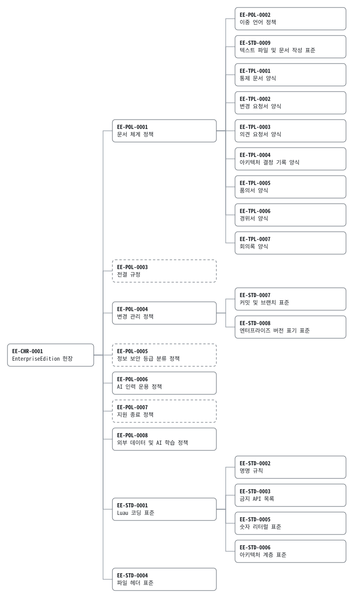

<!-- SPDX-License-Identifier: MIT -->
<!-- SPDX-FileCopyrightText: 2026 Hawakiki and EnterpriseEdition contributors -->
<!-- GENERATED FILE. DO NOT EDIT. Regenerate with: lune run scripts/gen_registry -->

# 문서 대장

EnterpriseEdition 의 모든 통제 문서와 기록. `scripts/gen_registry.luau` 가 문서 frontmatter 로부터 생성한다.
이 파일을 손으로 고치는 것은 EE-POL-0001 위반이며, checkpatch 가 알아챈다.

[English](REGISTRY.md)

## 요약

| 구분 | 문서 수 |
|---|---:|
| 헌장 | 1 |
| 정책 | 8 |
| 조직 | 1 |
| 표준 | 9 |
| 양식 | 7 |
| 아키텍처 결정 기록 | 1 |
| 변경 요청 | 22 |
| **합계** | **49** |

## 계보

모든 통제 문서를, 그 문서가 상위 문서로 인용하는 문서 옆에 그린다. 점선 카드는 확보만 해 둔 번호이고, 굵은 카드는 검토 중인 문서이다.



<details>
<summary>텍스트판</summary>

```text
EE-CHR-0001 EnterpriseEdition 헌장
├─ EE-POL-0001 문서 체계 정책
│  ├─ EE-POL-0002 이중 언어 정책
│  ├─ EE-STD-0009 텍스트 파일 및 문서 작성 표준
│  ├─ EE-TPL-0001 통제 문서 양식
│  ├─ EE-TPL-0002 변경 요청서 양식
│  ├─ EE-TPL-0003 의견 요청서 양식
│  ├─ EE-TPL-0004 아키텍처 결정 기록 양식
│  ├─ EE-TPL-0005 품의서 양식
│  ├─ EE-TPL-0006 경위서 양식
│  └─ EE-TPL-0007 회의록 양식
├─ EE-POL-0003 전결 규정
├─ EE-POL-0004 변경 관리 정책
│  ├─ EE-STD-0007 커밋 및 브랜치 표준
│  └─ EE-STD-0008 엔터프라이즈 버전 표기 표준
├─ EE-POL-0005 정보 보안 등급 분류 정책 (예약)
├─ EE-POL-0006 AI 인력 운용 정책
├─ EE-POL-0007 지원 종료 정책 (예약)
├─ EE-POL-0008 외부 데이터 및 AI 학습 정책
├─ EE-ORG-0001 조직도
├─ EE-STD-0001 Luau 코딩 표준
│  ├─ EE-STD-0002 명명 규칙
│  ├─ EE-STD-0003 금지 API 목록 (검토 중)
│  ├─ EE-STD-0005 숫자 리터럴 표준
│  └─ EE-STD-0006 아키텍처 계층 표준
└─ EE-STD-0004 파일 헤더 표준
```

</details>

## 헌장

| ID | 제목 | 버전 | 상태 | 보안 등급 | 소유 부서 | 상위 문서 |
|---|---|---|---|---|---|---|
| [EE-CHR-0001](00-charter/EE-CHR-0001-charter.ko.md) | EnterpriseEdition 헌장 | 1.0.0 | 승인 | 공개 | Board of Directors | — |

## 정책

| ID | 제목 | 버전 | 상태 | 보안 등급 | 소유 부서 | 상위 문서 |
|---|---|---|---|---|---|---|
| [EE-POL-0001](01-governance/EE-POL-0001-document-governance.ko.md) | 문서 체계 정책 | 1.1.0 | 승인 | 사내 한정 | Document Control Office | EE-CHR-0001@1.0 |
| [EE-POL-0002](01-governance/EE-POL-0002-bilingual-documentation.ko.md) | 이중 언어 정책 | 1.1.0 | 승인 | 사내 한정 | Document Control Office | EE-POL-0001@1.1 |
| [EE-POL-0003](01-governance/EE-POL-0003-delegation-of-authority.ko.md) | 전결 규정 | 1.0.0 | 승인 | 사내 한정 | Board of Directors | EE-CHR-0001@1.0 |
| [EE-POL-0004](01-governance/EE-POL-0004-change-management.ko.md) | 변경 관리 정책 | 1.1.0 | 승인 | 사내 한정 | Change Advisory Board | EE-CHR-0001@1.0 |
| [EE-POL-0005](01-governance/EE-POL-0005-information-classification.ko.md) | 정보 보안 등급 분류 정책 | 0.1.0 | 초안 | 사내 한정 | Information Security Office | EE-CHR-0001@1.0 |
| [EE-POL-0006](01-governance/EE-POL-0006-ai-workforce.ko.md) | AI 인력 운용 정책 | 1.1.0 | 승인 | 사내 한정 | Human Resources | EE-CHR-0001@1.0 |
| [EE-POL-0007](01-governance/EE-POL-0007-deprecation.ko.md) | 지원 종료 정책 | 0.1.0 | 초안 | 사내 한정 | Release Engineering | EE-CHR-0001@1.0 |
| [EE-POL-0008](01-governance/EE-POL-0008-external-data-and-ai-training.ko.md) | 외부 데이터 및 AI 학습 정책 | 1.0.0 | 승인 | 사내 한정 | Legal Department | EE-CHR-0001@1.0 |

## 조직

| ID | 제목 | 버전 | 상태 | 보안 등급 | 소유 부서 | 상위 문서 |
|---|---|---|---|---|---|---|
| [EE-ORG-0001](02-organization/EE-ORG-0001-organization-chart.ko.md) | 조직도 | 1.0.0 | 승인 | 사내 한정 | Human Resources | EE-CHR-0001@1.0 |

## 표준

| ID | 제목 | 버전 | 상태 | 보안 등급 | 소유 부서 | 상위 문서 |
|---|---|---|---|---|---|---|
| [EE-STD-0001](03-standards/EE-STD-0001-luau-coding.ko.md) | Luau 코딩 표준 | 1.1.0 | 승인 | 사내 한정 | Architecture Review Board | EE-CHR-0001@1.0 |
| [EE-STD-0002](03-standards/EE-STD-0002-naming.ko.md) | 명명 규칙 | 1.0.1 | 승인 | 사내 한정 | Architecture Review Board | EE-STD-0001@1.1 |
| [EE-STD-0003](03-standards/EE-STD-0003-prohibited-apis.ko.md) | 금지 API 목록 | 1.1.0 | 검토 중 | 사내 한정 | Architecture Review Board | EE-STD-0001@1.1 |
| [EE-STD-0004](03-standards/EE-STD-0004-file-headers.ko.md) | 파일 헤더 표준 | 1.1.0 | 승인 | 사내 한정 | Legal Department | EE-CHR-0001@1.0 |
| [EE-STD-0005](03-standards/EE-STD-0005-numeric-literals.ko.md) | 숫자 리터럴 표준 | 1.0.0 | 승인 | 사내 한정 | Architecture Review Board | EE-STD-0001@1.1 |
| [EE-STD-0006](03-standards/EE-STD-0006-architecture-layers.ko.md) | 아키텍처 계층 표준 | 1.0.1 | 승인 | 사내 한정 | Architecture Review Board | EE-STD-0001@1.1 |
| [EE-STD-0007](03-standards/EE-STD-0007-commits-and-branches.ko.md) | 커밋 및 브랜치 표준 | 1.0.1 | 승인 | 사내 한정 | Compliance Engineering | EE-POL-0004@1.1 |
| [EE-STD-0008](03-standards/EE-STD-0008-versioning.ko.md) | 엔터프라이즈 버전 표기 표준 | 1.1.0 | 승인 | 사내 한정 | Release Engineering | EE-POL-0004@1.1 |
| [EE-STD-0009](03-standards/EE-STD-0009-text-and-documentation.ko.md) | 텍스트 파일 및 문서 작성 표준 | 1.0.1 | 승인 | 사내 한정 | Document Control Office | EE-POL-0001@1.1 |

## 양식

| ID | 제목 | 버전 | 상태 | 보안 등급 | 소유 부서 | 상위 문서 |
|---|---|---|---|---|---|---|
| [EE-TPL-0001](templates/EE-TPL-0001-controlled-document.ko.md) | 통제 문서 양식 | 1.0.1 | 승인 | 사내 한정 | Document Control Office | EE-POL-0001@1.1 |
| [EE-TPL-0002](templates/EE-TPL-0002-change-request.ko.md) | 변경 요청서 양식 | 1.1.0 | 승인 | 사내 한정 | Document Control Office | EE-POL-0001@1.1 |
| [EE-TPL-0003](templates/EE-TPL-0003-request-for-comments.ko.md) | 의견 요청서 양식 | 1.0.1 | 승인 | 사내 한정 | Document Control Office | EE-POL-0001@1.1 |
| [EE-TPL-0004](templates/EE-TPL-0004-architecture-decision-record.ko.md) | 아키텍처 결정 기록 양식 | 1.0.1 | 승인 | 사내 한정 | Document Control Office | EE-POL-0001@1.1 |
| [EE-TPL-0005](templates/EE-TPL-0005-approval-request.ko.md) | 품의서 양식 | 1.0.1 | 승인 | 사내 한정 | Document Control Office | EE-POL-0001@1.1 |
| [EE-TPL-0006](templates/EE-TPL-0006-statement-of-circumstances.ko.md) | 경위서 양식 | 1.0.1 | 승인 | 사내 한정 | Document Control Office | EE-POL-0001@1.1 |
| [EE-TPL-0007](templates/EE-TPL-0007-meeting-minutes.ko.md) | 회의록 양식 | 1.0.1 | 승인 | 사내 한정 | Document Control Office | EE-POL-0001@1.1 |

## 아키텍처 결정 기록

| ID | 제목 | 버전 | 상태 | 보안 등급 | 소유 부서 |
|---|---|---|---|---|---|
| [ADR-0001](adr/ADR-0001-constructors-return-their-contract.ko.md) | 생성자는 any 캐스트로 자기 계약을 반환한다 | 1.1.0 | 채택 | 사내 한정 | Architecture Review Board |

## 변경 요청

| ID | 제목 | 버전 | 상태 | 보안 등급 | 소유 부서 |
|---|---|---|---|---|---|
| [CR-0001](records/change-requests/CR-0001-compliance-tooling.ko.md) | 변경 요청 제도 및 규정 준수 도구 도입 | 1.1.0 | 시행 | 사내 한정 | Compliance Engineering |
| [CR-0002](records/change-requests/CR-0002-stray-luaurc.ko.md) | 루트에 잘못 들어간 .luaurc 제거 | 1.2.0 | 시행 | 사내 한정 | Compliance Engineering |
| [CR-0003](records/change-requests/CR-0003-document-governance.ko.md) | 헌장, 문서 체계 정책 및 양식 제정 | 1.2.0 | 시행 | 사내 한정 | Document Control Office |
| [CR-0004](records/change-requests/CR-0004-engineering-standards.ko.md) | 변경 관리 정책 및 엔지니어링 표준 제정 | 1.2.0 | 시행 | 사내 한정 | Compliance Engineering |
| [CR-0005](records/change-requests/CR-0005-ai-onboarding.ko.md) | AI 인력 온보딩 | 1.2.0 | 시행 | 사내 한정 | Human Resources |
| [CR-0006](records/change-requests/CR-0006-drill-findings.ko.md) | 첫 신입 투입 훈련 지적 사항 정정 | 1.1.0 | 시행 | 사내 한정 | Document Control Office |
| [CR-0007](records/change-requests/CR-0007-application-framework.ko.md) | 애플리케이션 프레임워크 수립 | 1.1.0 | 시행 | 사내 한정 | Architecture Review Board |
| [CR-0008](records/change-requests/CR-0008-law-of-the-code.ko.md) | 로블록스 코드의 규율 확립 | 1.3.0 | 시행 | 사내 한정 | Architecture Review Board |
| [CR-0009](records/change-requests/CR-0009-first-assignment-findings.ko.md) | 첫 실전 배치 지적 사항 정정 | 1.1.0 | 시행 | 사내 한정 | Architecture Review Board |
| [CR-0010](records/change-requests/CR-0010-presentation-framework.ko.md) | 프레젠테이션 프레임워크 구축 | 1.1.0 | 시행 | 사내 한정 | Architecture Review Board |
| [CR-0011](records/change-requests/CR-0011-compliance-coins.ko.md) | 정책 확인에 대한 준법 코인 보상 | 1.1.0 | 시행 | 사내 한정 | Architecture Review Board |
| [CR-0012](records/change-requests/CR-0012-datastore-wallets.ko.md) | 세션 락 아래 DataStore 에 준법 코인 보관 | 1.1.0 | 시행 | 사내 한정 | Architecture Review Board |
| [CR-0013](records/change-requests/CR-0013-publication.ko.md) | 회사 공개 준비 | 1.1.0 | 시행 | 사내 한정 | Architecture Review Board |
| [CR-0014](records/change-requests/CR-0014-release-1-0-0.ko.md) | EnterpriseEdition 1.0.0 릴리스 | 1.2.0 | 시행 | 사내 한정 | Architecture Review Board |
| [CR-0015](records/change-requests/CR-0015-ci-hardening.ko.md) | 지속적 통합 강화 | 1.2.0 | 시행 | 사내 한정 | Release Engineering |
| [CR-0016](records/change-requests/CR-0016-release-engineering.ko.md) | 릴리스의 번호, 관문, 게시 | 1.2.0 | 시행 | 사내 한정 | Release Engineering |
| [CR-0017](records/change-requests/CR-0017-release-1-1-0.ko.md) | EnterpriseEdition 1.1.0 릴리스 | 1.2.0 | 시행 | 사내 한정 | Release Engineering |
| [CR-0018](records/change-requests/CR-0018-code-review-findings.ko.md) | 첫 코드 리뷰 지적 사항 정정 | 1.1.0 | 시행 | 사내 한정 | Architecture Review Board |
| [CR-0019](records/change-requests/CR-0019-contract-decision-record.ko.md) | 계약 패턴을 첫 아키텍처 결정으로 기록 | 1.2.0 | 시행 | 사내 한정 | Architecture Review Board |
| [CR-0020](records/change-requests/CR-0020-adr-0001-fitness-test.ko.md) | ADR-0001 이 기대는 사실을 검사 | 1.1.0 | 시행 | 사내 한정 | Architecture Review Board |
| [CR-0021](records/change-requests/CR-0021-company-map.ko.md) | 회사 지도 그리기 | 1.2.0 | 시행 | 사내 한정 | Document Control Office |
| [CR-0022](records/change-requests/CR-0022-random-numbers.ko.md) | 전역 난수 생성기 금지 | 1.2.0 | 시행 | 사내 한정 | Architecture Review Board |
